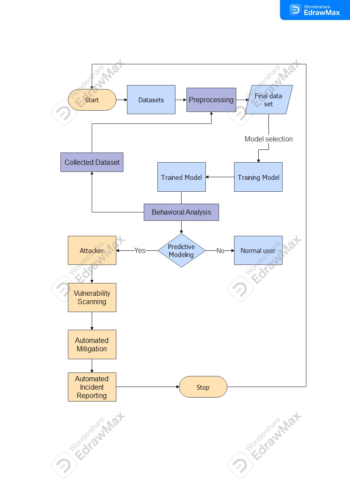

# AI-Powered Threat Detection System

**Graduation project, B.Sc. Cybersecurity, Philadelphia University**

A machine-learning detection pipeline that classifies network flows as **normal or malicious** using a **stacking ensemble** (Random Forest + XGBoost + TabNet, combined by a Logistic Regression meta-model). Predictions are served through a **Flask API**, visualised in a **Streamlit SOC dashboard**, and enriched with **MITRE ATT&CK** technique context.



## Results

Trained on the preprocessed UNSW-NB15 testing partition (82,332 flows, 42 features, 55% malicious).
All numbers below are on a **held-out 20% test split** that none of the models saw during training.

| Model | Accuracy | Precision | Recall | F1 | ROC-AUC |
|---|---|---|---|---|---|
| Random Forest | 97.61% | 98.27% | 97.36% | 97.82% | 0.9969 |
| XGBoost | 97.73% | 98.46% | 97.40% | 97.93% | 0.9974 |
| TabNet | 93.76% | 93.61% | 95.16% | 94.38% | 0.9849 |
| **Stacking Ensemble** | **97.75%** | 98.31% | **97.60%** | **97.95%** | **0.9975** |

The ensemble gives the best recall and F1, the metrics that matter most for a detection system (fewer missed attacks). Full output: [`models/metrics.json`](models/metrics.json).

## Architecture

```
UNSW-NB15 flows ──► train_models.py ──► RF / XGBoost / TabNet ──► Logistic Regression meta-model
                                                                         │
           live_client.py / dashboard.py ──► Flask API (/predict) ◄──────┘
                                                  │
                                    threat score + risk level + MITRE ATT&CK context
```

| Component | File | Purpose |
|---|---|---|
| Training | `src/train_models.py` | 60/20/20 split: base models → meta-model → held-out evaluation |
| API | `src/api.py` | `POST /predict` for one record or a batch; returns score, label, risk (High > 0.9, Medium ≥ 0.7, Low) |
| ATT&CK lookup | `src/attack_lookup.py` | Offline technique name, tactic, description and URL from the Enterprise STIX bundle |
| Live feed | `src/live_client.py` | Replays flows against the API like a real-time log stream |
| Dashboard | `src/dashboard.py` | Upload CSV logs, filter by score, risk distribution, score timeline |
| Notebooks | `notebooks/` | Original Colab experiments: stacking ensemble, plus RF + SHAP explainability and an LSTM next-TTP prediction experiment |

## Run it

```bash
pip install -r requirements.txt
# put UNSW-NB15-processed.csv in data/ (see data/README.md)
python src/train_models.py             # ~1 minute on CPU
python src/api.py                      # http://127.0.0.1:5000
python src/live_client.py --limit 25   # simulated live feed
streamlit run src/dashboard.py         # SOC dashboard
```

Example request:

```bash
curl -X POST http://127.0.0.1:5000/predict -H "Content-Type: application/json" \
     -d '{"dur": 0.12, "proto": 117, "service": 0, "sbytes": 1000, "attack_ttp": "T1595"}'
```

```json
{"threat_score": 0.9962, "predicted_label": 1, "risk": "High", "attack_ttp": "T1595", "attack_context": {...}}
```

## Design notes

- **No label leakage.** `attack_cat` and `attack_ttp` are derived from the ground truth, so they are excluded from the features. `attack_ttp` is only used to add ATT&CK context to alerts.
- **Proper stacking.** The meta-model is trained on base-model predictions for a separate split, not on the test set.
- **ATT&CK mapping used in the dataset:** Exploits → T1203, Fuzzers → T1046, DoS → T1498, Reconnaissance → T1595, Analysis → T1598, Shellcode → T1055, Worms → T1105.

## Future work

- Multi-class prediction of the attack category, not just normal/malicious
- Stream ingestion from a SIEM (Wazuh/Splunk) or Kafka instead of CSV replay
- SHAP explanations per alert inside the dashboard
- Evaluation on the separate UNSW-NB15 training partition and on CIC-IDS2017 for generalisation

**Tech:** Python, pandas, scikit-learn, XGBoost, PyTorch TabNet, Flask, Streamlit, MITRE ATT&CK
