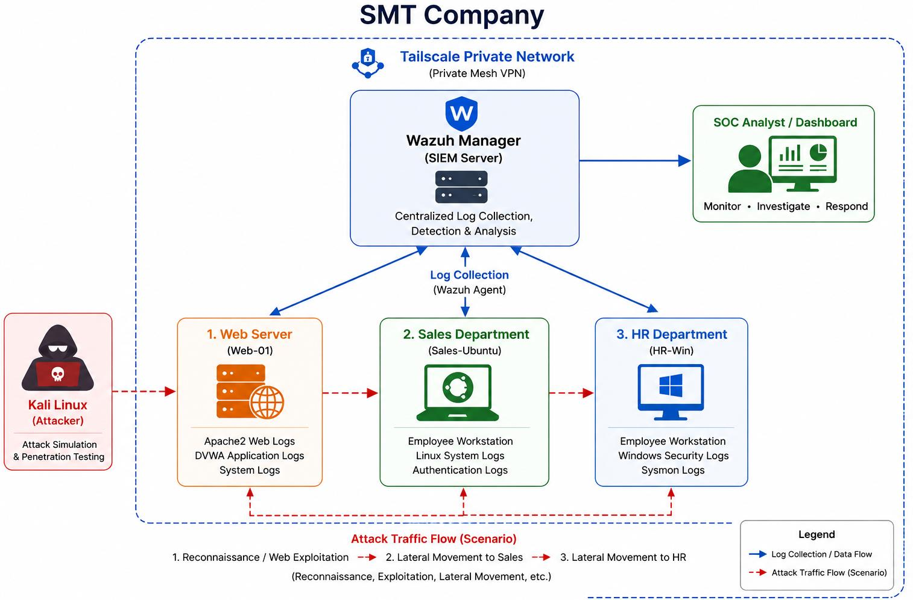
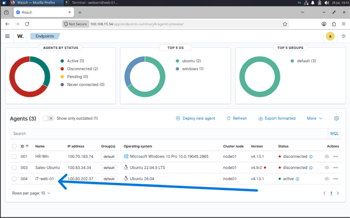
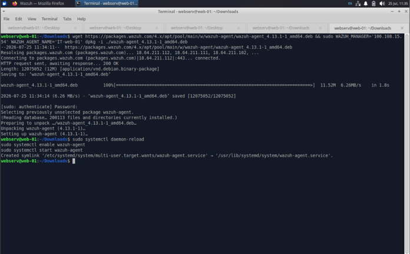
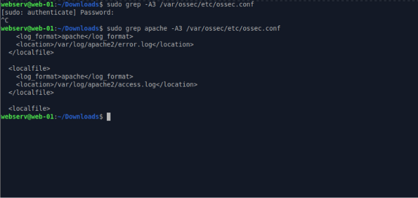
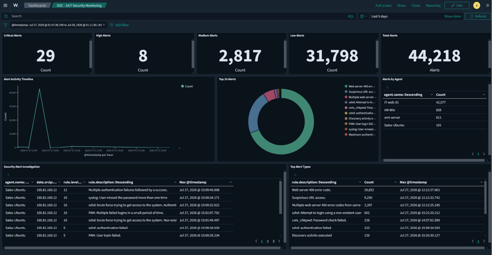
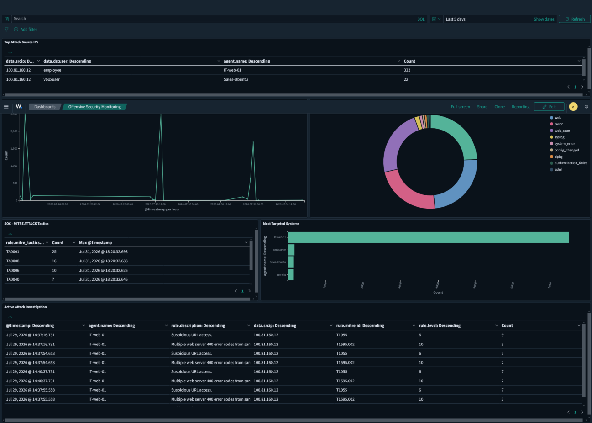

# Mini SOC & Detection Lab (Wazuh)

**Team project, SOC L1 training program at SMT Group (Security Management Technology Group)**

A working Security Operations Center lab built from scratch: a Wazuh SIEM monitoring a simulated three-department company, a Kali attacker running a full attack chain, **15 custom detection rules**, two SOC dashboards and an L1 triage write-up for every alert.

**Result: 13 of 13 simulated attack scenarios detected and mapped to MITRE ATT&CK.**

## Lab environment

| Host | Role | OS / stack | Telemetry |
|---|---|---|---|
| Wazuh Manager | SIEM: collection, rules, alerting, dashboards | Wazuh 4.x | — |
| **IT-Web-01** | Attack target: web server | Ubuntu Server, Apache2, PHP, MariaDB, DVWA, custom SMT Employee Portal | Apache access/error logs, custom portal auth log, auditd, syslog |
| Sales-Ubuntu | Employee workstation | Ubuntu 22.04 LTS | auth.log, sudo, SSH, auditd |
| HR-Win | Employee workstation | Windows 10 Pro + Sysmon | Windows Security events, Sysmon |
| Kali Linux | Attacker | Nmap, Gobuster, Nikto, Hydra, manual SQL injection | — |

All machines were on different team members' PCs, so they were joined with a **Tailscale private mesh VPN**, keeping the lab isolated from the internet while letting the agents report to one manager.

## My part: IT-Web-01 web server and log onboarding

- Deployed the Ubuntu server that hosts the attack surface: Apache2, PHP 8.5, MariaDB and DVWA.
- Installed and enrolled the Wazuh agent and configured Apache access/error log collection (`<localfile>` with `log_format apache`).
- Prepared the attack surface for the reconnaissance → exploitation → lateral movement chain.

| Agent install & enrollment | Apache log collection |
|---|---|
|  |  |

## Attack → detection coverage

| Tactic | Simulated attack | Target | Rule(s) | MITRE ATT&CK | Detected |
|---|---|---|---|---|---|
| Reconnaissance | Nmap NSE scan | IT-Web-01 | 100500 | T1595 | ✅ |
| Reconnaissance | Gobuster directory enumeration / Nikto | IT-Web-01 | 100000 | T1595.002 | ✅ |
| Initial Access | Hydra brute force on web login | SMT Portal | 100001–100004 | T1110.001 | ✅ |
| Initial Access | SQL injection + authentication bypass | SMT Portal | 100005–100006 | T1190 | ✅ |
| Execution | Bash reverse shell (`/dev/tcp`) | IT-Web-01 | 100007 | T1059.004 | ✅ |
| Persistence | Cron job creation | IT-Web-01 | built-in 2833 | T1053.003 | ✅ |
| Privilege Escalation | `sudo su -` | Sales-Ubuntu | 100008 | T1548.003 | ✅ |
| Credential Access | Reading credential files | Linux hosts | 100009 | T1005 | ✅ |
| Lateral Movement | SSH with discovered credentials | Sales-Ubuntu | 100010 | T1021.004 | ✅ |
| Credential Access | RDP brute force | HR-Win | 100011 | T1110.001 | ✅ |
| Lateral Movement | Successful login after brute force | HR-Win | 100012 | T1110.001, T1021.001 | ✅ |
| Collection | Opening the confidential employee directory | HR-Win | 100013 | T1005 | ✅ |

## Detection engineering

All rules are in [`rules/local_rules.xml`](rules/local_rules.xml). Highlights:

- **Correlation instead of single events.** Web brute force escalates from failed login (100001, level 5) → 10 failures from one IP in 60 s (100002, level 10) → successful login from that same IP (100004, level 14). The Windows rules work the same way: 3 failed logons in 60 s (100011), then Event ID 4624 from the same IP (100012).
- **Extending built-in rules to cut noise.** `sudo su -` detection inherits built-in sudo rule 5402 and only fires on a root shell, not on everyday sudo use. Credential discovery inherits auditd rule 80700 and only fires on the `credential_access` audit key, so it catches `cat`, `nano` or any other reader.
- **Custom log source.** The SMT Employee Portal had no Wazuh decoder, so the portal writes structured auth events (`FAILED | user=… | ip=…`, `SUCCESS | …`, `SQLI_ATTEMPT`) that the agent forwards and the rules parse.
- **Attack-tool fingerprints.** Nmap NSE and Gobuster are caught by their User-Agent strings in Apache logs (PCRE2).

Rule development loop used for every detection: *run attack → verify raw log → pick decoder/parent rule → write rule → test with `wazuh-logtest` → tune false positives.*

## Dashboards

| SOC 24/7 Security Monitoring | Offensive Security Monitoring |
|---|---|
|  |  |

The first dashboard covers alert severity, an activity timeline, alerts per agent and an investigation table. The second covers attack sources, ATT&CK tactics, targeted hosts and attack drill-down.

## Triage workflow (L1)

For each alert: **validate** the raw event → **scope** (host, user, source IP, timeframe) → **decide** true or false positive with justification → **recommend** next steps (block the IP, reset credentials, isolate the host, escalate to L2).

## Challenges

- **Distributed team:** VirtualBox NAT and host-only networks couldn't connect machines on different PCs, so we used a Tailscale mesh for every host.
- **Agent connectivity:** several agents failed to enroll at first. We fixed it by checking the manager address, VPN reachability and service restarts.
- **Rules not firing:** the causes were wrong parent rule IDs, decoder mismatches, XML errors and regex mismatches. We fixed them by testing every rule against real logs in `wazuh-logtest`.

## Team

Built by a six-person team in SMT Group's SOC L1 program under the supervision of SMT engineers. Shared here with my own section and the team's detection rules.

**Skills:** Wazuh · SIEM · Sysmon · auditd · detection engineering · alert correlation · MITRE ATT&CK · Linux & Windows logging · Apache · Kali Linux · Tailscale
