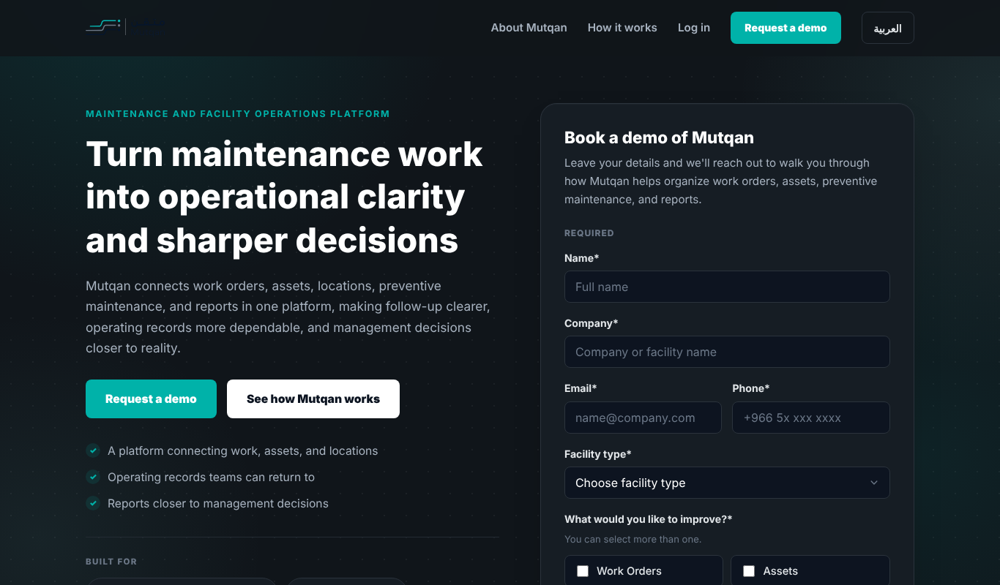
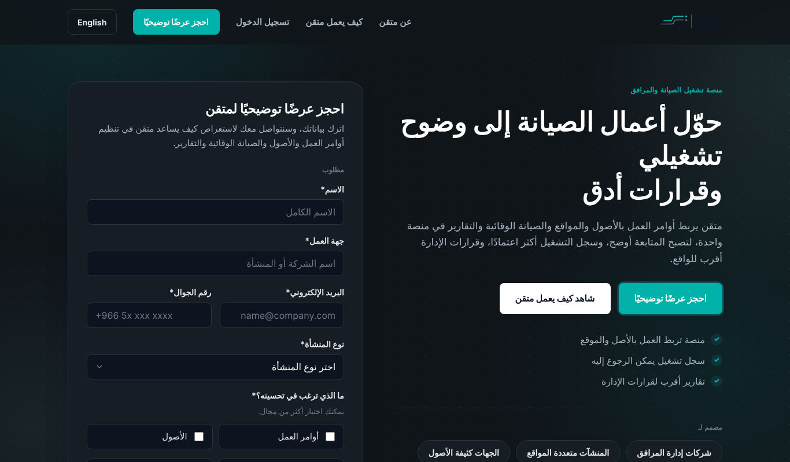
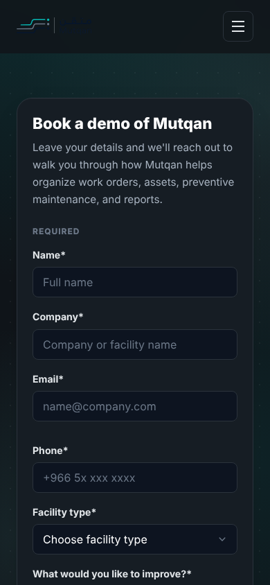

# Mutqan (متقن): Bilingual Lead-Generation Landing Page

**Freelance project for Mutqan, a Saudi SaaS platform for maintenance and facility operations**

A responsive, bilingual **Arabic (RTL) / English (LTR)** landing page that presents the product and captures demo requests from facility-management companies. It's built as a static site with no framework.

| English | Arabic (RTL) |
|---|---|
|  |  |



## Features

- **Language switching:** a dictionary-based i18n layer (`js/i18n.js`) swaps every string and flips the layout direction (`dir="rtl"` / `ltr`) without a page reload.
- **Lead-capture form:** name, company, email, mobile, facility type and areas to improve (multi-select). Fields are validated client-side, and submission opens a pre-filled email to the sales team, so there is no backend to secure or maintain.
- **Design system:** colour tokens, typography (Cairo for Arabic and Latin) and spacing rules documented in [`docs/design-system.md`](docs/design-system.md) and implemented as CSS custom properties.
- **Responsive and accessible:** mobile-first layout, semantic sections, labelled inputs, keyboard-friendly controls.
- **Iterated with the client:** earlier drafts are kept in [`drafts/`](drafts/) (v1 mockup → v2 → final).

## Structure

```
site/
├── index.html        # page markup (sections: hero + form, about, workflow, footer)
├── css/styles.css    # design tokens, layout, RTL/LTR rules
├── js/i18n.js        # Arabic / English dictionaries
├── js/main.js        # language toggle, form validation, mailto submission
└── assets/favicon.svg
```

## Run locally

```bash
cd site && python -m http.server 8000   # open http://localhost:8000
```

## My role

Technical delivery end to end: page structure, bilingual copy integration, styling, form logic and several client revision rounds. I also wrote the Arabic and English project proposals.

**Tech:** HTML5 · CSS3 (custom properties, flexbox/grid, RTL) · vanilla JavaScript · i18n

*Mutqan name and logo belong to Mutqan. Shared with permission as portfolio work.*
